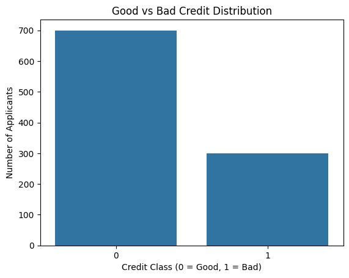
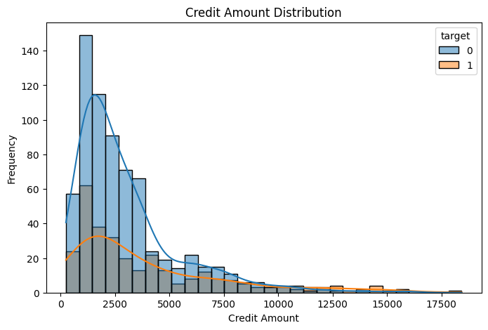
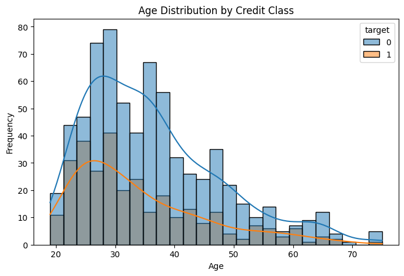
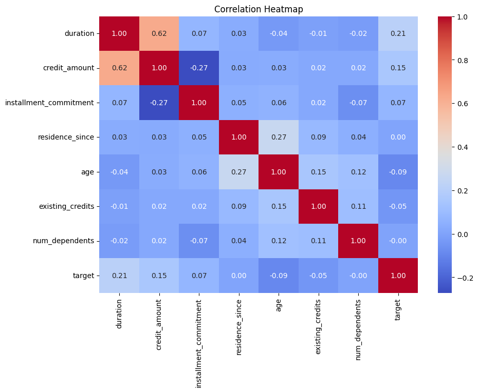
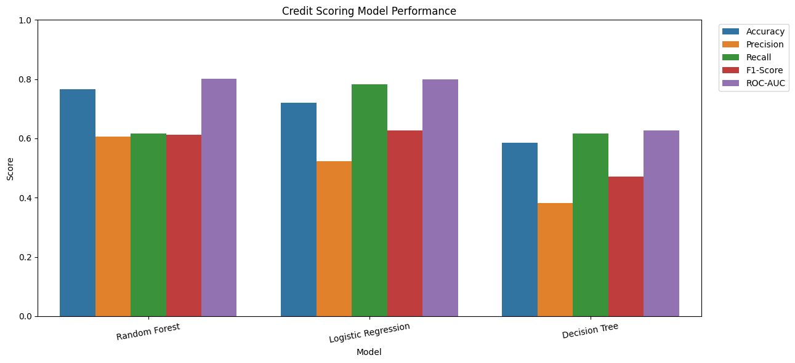
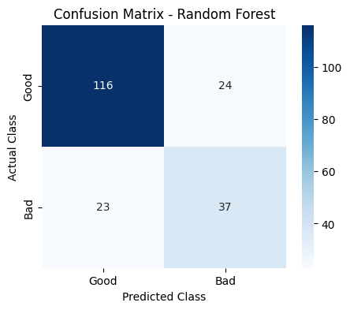
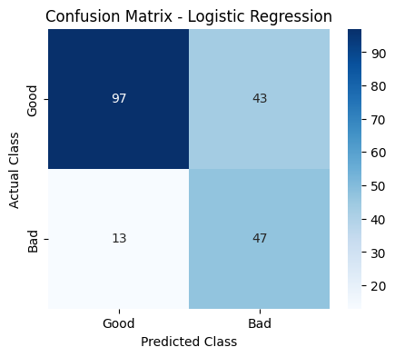
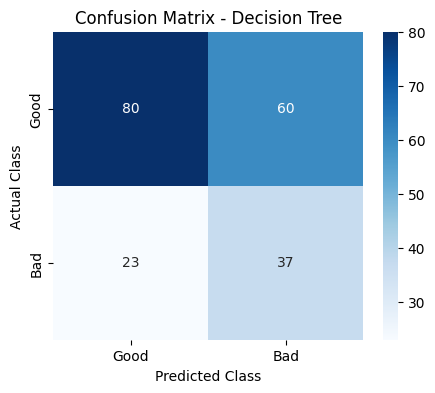
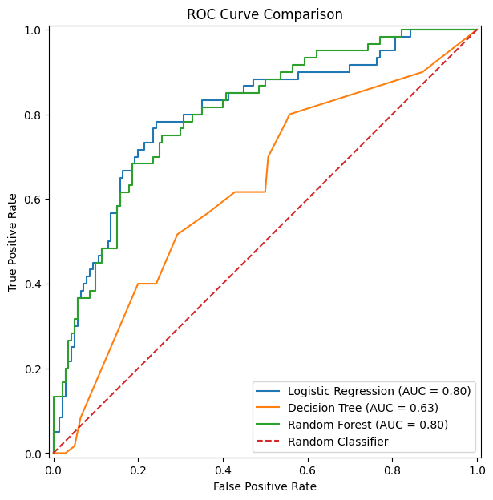
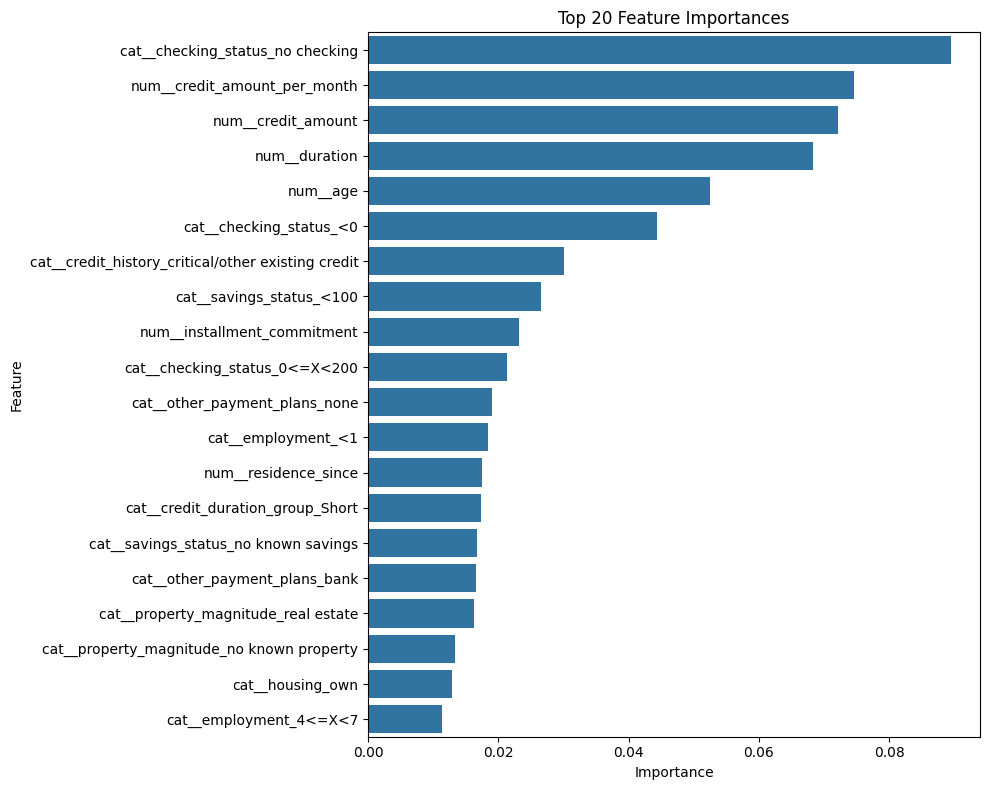

Credit Scoring Model.ipynb ei code dekhe sundor kore root e akta README.md file likhe daw full report image datset technology result ecpoc batch sob kichu sundor  kor elikha tthakbe..Credit Scoring & Risk Prediction Model

[](https://www.python.org/)
[](https://scikit-learn.org/)
[](https://pandas.pydata.org/)
[](https://numpy.org/)
[](https://www.openml.org/d/31)
[]()

An end-to-end Machine Learning pipeline designed to evaluate loan applicants' creditworthiness, predict default probability, and empower financial institutions with data-driven credit risk assessment.

---

## Table of Contents
1. [Executive Summary](#-executive-summary)
2. [Dataset Overview & Data Dictionary](#-dataset-overview--data-dictionary)
3. [Exploratory Data Analysis (EDA)](#-exploratory-data-analysis-eda)
4. [Feature Engineering & Pipeline Architecture](#-feature-engineering--pipeline-architecture)
5. [Training Setup, Iterations & Batch Processing](#-training-setup-iterations--batch-processing)
6. [Model Evaluation & Benchmark Results](#-model-evaluation--benchmark-results)
7. [Hyperparameter Optimization](#-hyperparameter-optimization)
8. [Feature Importance & Risk Drivers](#-feature-importance--risk-drivers)
9. [Sample Applicant Prediction & Inference API](#-sample-applicant-prediction--inference-api)
10. [Technology Stack](#-technology-stack)
11. [Repository Structure](#-repository-structure)
12. [How to Run & Reproduce](#-how-to-run--reproduce)

---

## Executive Summary

Credit scoring is an essential tool utilized by financial institutions, retail banks, and fintech platforms to quantify the likelihood that a borrower will fail to meet debt obligations (credit default). Accurate risk scoring optimizes portfolio yield, minimizes **Non-Performing Loans (NPLs)**, and accelerates lending decisions.

This project delivers:
- **Comprehensive Data Ingestion & Sanitization** on the benchmark German Credit Risk dataset.
- **Robust Feature Engineering** generating monthly debt obligations and multi-tiered age/duration classifications.
- **Production-grade Scikit-Learn Pipeline** integrating missing-value imputation, standardized scaling, and one-hot encoding without data leakage.
- **Ensemble & Linear Model Benchmarking** evaluating Logistic Regression, Decision Tree, and Random Forest models.
- **Automated Hyperparameter Optimization** using 5-Fold Stratified Cross-Validation (`GridSearchCV`) across 540 fit iterations.
- **Exportable Model Artifact** serialized as `credit_scoring_model.pkl` for immediate inference deployment.

---

## Dataset Overview & Data Dictionary

The project utilizes the **German Credit Risk (Statlog German Credit Data)** fetched directly from OpenML (`data_id=31`).

| Attribute | Details |
| :--- | :--- |
| **Source** | OpenML / UCI Machine Learning Repository |
| **Total Observations** | 1,000 applicant records |
| **Raw Features** | 20 features (7 numerical, 13 categorical) |
| **Engineered Features** | 3 domain features (`credit_amount_per_month`, `age_group`, `credit_duration_group`) |
| **Total Predictor Features** | 23 features |
| **Target Variable** | Binary: `0` = Good Credit (Low Risk), `1` = Bad Credit (High Risk) |
| **Class Distribution** | 700 Good (70.0%) vs. 300 Bad (30.0%) — Moderate class imbalance |

### Key Features Summary
- **Financial Status:** `checking_status`, `savings_status`, `existing_credits`, `installment_commitment`
- **Credit Parameters:** `duration` (loan duration in months), `credit_amount`, `purpose`
- **Applicant Demographics:** `age`, `personal_status`, `job`, `housing`, `property_magnitude`, `employment`, `foreign_worker`, `other_parties`

---

## Exploratory Data Analysis (EDA)

Exploratory analysis was performed to inspect applicant distributions, financial indicators, and delinquency tendencies.

### 1. Target Class Imbalance
The dataset contains a 70:30 ratio of creditworthy to delinquent borrowers. To avoid algorithmic bias toward the majority class, all estimators integrate `class_weight="balanced"`.

<p align="center">
  
</p>

### 2. Credit Amount & Age Distribution
- Higher loan amounts correlate with increased default probability.
- Younger borrowers (under 25 years) exhibit a proportionally higher default rate compared to established applicants.

<p align="center">
  
  
</p>

### 3. Correlation Matrix
Pairwise correlation across numerical attributes indicates moderate positive correlation between `credit_amount` and loan `duration` (0.62), validating the creation of a normalized monthly credit obligation feature.

<p align="center">
  
</p>

---

## Feature Engineering & Pipeline Architecture

### 1. Domain Feature Engineering
Three domain-specific attributes were formulated prior to train/test partitioning:
1. **`credit_amount_per_month`**: Ratio of total credit amount to loan duration ($CreditAmount / Duration$), capturing monthly debt strain.
2. **`age_group`**: Discretized into `Young` ($\le 25$), `Early_Middle` ($26-35$), `Middle_Aged` ($36-50$), and `Older` ($> 50$).
3. **`credit_duration_group`**: Categorized into `Short` ($\le 12$ mo), `Medium` ($13-24$ mo), `Long` ($25-48$ mo), and `Very_Long` ($> 48$ mo).

### 2. Scikit-Learn Preprocessing Pipelines
Features are dynamically segregated and processed using `ColumnTransformer` to prevent data leakage:

```text
Input Features (23 Columns)
│
├── Numerical Features (8) ──> [SimpleImputer (median)] ──> [StandardScaler()]
│
└── Categorical Features (15) ─> [SimpleImputer (most_frequent)] ─> [OneHotEncoder (handle_unknown='ignore')]
```

- **Stratified Partitioning:** 80% Training (800 records) and 20% Testing (200 records), maintaining exact target distribution across both subsets (`stratify=y`, `random_state=42`).

---

## Training Setup, Iterations & Batch Processing

In classical tabular Machine Learning, optimization and sampling follow specialized batch partitions, cross-validation batches, and iterative solvers:

| Training Spec | Configuration & Value | Description |
| :--- | :--- | :--- |
| **Learning Paradigm** | Supervised Classification | Binary risk classification with cost-sensitive class balancing |
| **Training Batch Size** | **800 instances** | Partitioned training batch processed simultaneously |
| **Test Batch Size** | **200 instances** | Independent holdout evaluation batch |
| **CV Validation Fold Batch** | **160 instances per fold** | 5-Fold Stratified Cross-Validation ($800 / 5 = 160$ holdout per fold) |
| **Logistic Regression Solver** | **`max_iter = 2000`** | L-BFGS convergence iterations for optimization |
| **Random Forest Estimators** | **`n_estimators = 300`** | 300 decision tree ensemble bagging estimators |
| **GridSearch Total Fits** | **540 Fits** | 108 parameter candidates $\times$ 5 folds cross-validation |
| **Random State / Seed** | **42** | Deterministic seed ensuring exact reproducibility |

---

## Model Evaluation & Benchmark Results

Three baseline architectures were trained and validated against the unseen 200-sample test batch:

### Comparative Performance Table

| Model | Accuracy | Precision (Bad) | Recall (Bad) | F1-Score (Bad) | ROC-AUC |
| :--- | :---: | :---: | :---: | :---: | :---: |
| **Random Forest** | **0.7650** | **0.6066** | **0.6167** | **0.6116** | **0.8010** |
| **Logistic Regression** | 0.7200 | 0.5222 | 0.7833 | 0.6267 | 0.7990 |
| **Decision Tree** | 0.5850 | 0.3814 | 0.6167 | 0.4713 | 0.6260 |

<p align="center">
  
</p>

### Confusion Matrices
The confusion matrices highlight each model's trade-off between false alarms (Type I error) and missed defaults (Type II error):

<p align="center">
  
  
  
</p>

---

## Hyperparameter Optimization

A hyperparameter grid search was executed on the top-performing Random Forest pipeline using `GridSearchCV`:

### Search Space
```python
param_grid = {
    "classifier__n_estimators": [100, 200, 300],
    "classifier__max_depth": [5, 10, 15, None],
    "classifier__min_samples_split": [2, 5, 10],
    "classifier__min_samples_leaf": [1, 3, 5]
}
```

### Optimal Configuration & Tuned Results
- **Optimal Hyperparameters:**
  - `classifier__n_estimators`: `300`
  - `classifier__max_depth`: `10`
  - `classifier__min_samples_split`: `10`
  - `classifier__min_samples_leaf`: `1`
- **Cross-Validation ROC-AUC:** **`0.7994`**
- **Test Set ROC-AUC:** **`0.7945`**
- **Test Accuracy:** **`76.50%`**
- **Bad Credit Precision / Recall:** **`60.32% / 63.33%`**

### ROC Curve Comparison
The Receiver Operating Characteristic (ROC) curve validates strong discriminative capacity ($AUC \approx 0.80$) well above the random baseline:

<p align="center">
  
</p>

---

## Feature Importance & Risk Drivers

Feature importances extracted from the tuned Random Forest classifier identify the primary indicators of financial risk:

<p align="center">
  
</p>

### Key Business Insights
1. **Checking Account Status (`checking_status_no checking` & `<0 DM`)**: Applicants without an active checking account or carrying negative balances have the strongest predictive correlation with default risk.
2. **Monthly Burden (`credit_amount_per_month`)**: Ranked 2nd in overall importance ($7.46\%$), demonstrating that cash flow strain per installment cycle is more predictive than raw loan amount alone.
3. **Credit Magnitude & Duration**: Total loan size and repayment period are critical drivers in determining whether debt service is sustainable.
4. **Applicant Age & Past Credit History**: Older applicants with seasoned payment records consistently register lower default probabilities.

---

## 💻 Sample Applicant Prediction & Inference API

A lightweight, production-ready inference utility is provided to score incoming loan applications:

```python
import joblib
import pandas as pd

# 1. Load serialized pipeline
model = joblib.load("credit_scoring_model.pkl")

# 2. Prediction function
def predict_creditworthiness(applicant_data: dict, model):
    applicant_df = pd.DataFrame([applicant_data])
    prediction = model.predict(applicant_df)[0]
    bad_prob = model.predict_proba(applicant_df)[0][1]
    
    return {
        "Decision": "Rejected (High Risk)" if prediction == 1 else "Approved (Low Risk)",
        "Predicted Class": "Bad Credit" if prediction == 1 else "Good Credit",
        "Default Probability": f"{bad_prob:.2%}"
    }

# 3. Example Applicant
sample_data = {
    "checking_status": "0<=X<200",
    "duration": 18,
    "credit_history": "existing paid",
    "purpose": "business",
    "credit_amount": 1913,
    "savings_status": ">=1000",
    "employment": "<1",
    "installment_commitment": 3,
    "personal_status": "male mar/wid",
    "other_parties": "none",
    "residence_since": 3,
    "property_magnitude": "real estate",
    "age": 35,
    "other_payment_plans": "bank",
    "housing": "own",
    "existing_credits": 1,
    "job": "skilled",
    "num_dependents": 1,
    "own_telephone": "yes",
    "foreign_worker": "yes",
    "credit_amount_per_month": 106.28,
    "age_group": "Middle_Aged",
    "credit_duration_group": "Medium"
}

result = predict_creditworthiness(sample_data, model)
print(result)
# Output: {'Decision': 'Approved (Low Risk)', 'Predicted Class': 'Good Credit', 'Default Probability': '38.54%'}
```

---

## Technology Stack

| Domain | Technology / Library | Usage |
| :--- | :--- | :--- |
| **Language** | Python 3.8+ | Core development & pipeline execution |
| **Data Manipulation** | Pandas & NumPy | Data cleaning, type conversion & array operations |
| **Data Acquisition** | OpenML (`fetch_openml`) | Standardized dataset loading |
| **Machine Learning** | Scikit-Learn (`sklearn`) | Pipelines, Transformers, Classifiers, GridSearch |
| **Visualization** | Matplotlib & Seaborn | Exploratory data analysis, ROC curves, feature importance |
| **Model Persistence** | Joblib | Model artifact serialization (`.pkl`) |
| **Environment** | Jupyter Notebook / Google Colab | Interactive development & experimentation |

---

## Repository Structure

```text
CodeAlpha_CreditScoringModel/
│
├── assets/                                      # Exported analytical plots & figures
│   ├── age_distribution.png
│   ├── confusion_matrix_decision_tree.png
│   ├── confusion_matrix_logistic_regression.png
│   ├── confusion_matrix_random_forest.png
│   ├── correlation_heatmap.png
│   ├── credit_amount_distribution.png
│   ├── feature_importance_top20.png
│   ├── model_performance_comparison.png
│   ├── roc_curve_comparison.png
│   └── target_distribution.png
│
├── Credit Scoring Model .ipynb                  # Complete Jupyter notebook implementation
├── README.md                                    # Comprehensive technical documentation & report
```

---

## How to Run & Reproduce

### 1. Clone the Repository
```bash
git clone https://github.com/Mubasshir14/CodeAlpha_Credit_Scoring_Model-.git
cd CodeAlpha_Credit_Scoring_Model
```

### 2. Set Up a Virtual Environment
```bash
# Windows
python -m venv venv
venv\Scripts\activate

# macOS/Linux
python3 -m venv venv
source venv/bin/activate
```

### 3. Install Dependencies
```bash
pip install numpy pandas matplotlib seaborn scikit-learn joblib notebook
```

### 4. Launch Jupyter Notebook
```bash
jupyter notebook "Credit Scoring Model .ipynb"
```
Execute all cells sequentially from top to bottom to reproduce preprocessing, model training, cross-validation, and performance evaluation.

---

## 📄 License & Attribution
Developed as part of the **CodeAlpha Machine Learning Internship Program**.
- **Dataset Source:** Statlog German Credit Data, OpenML (`data_id=31`).
- **Author:** S. M. Mubasshir Al Kasshaf

